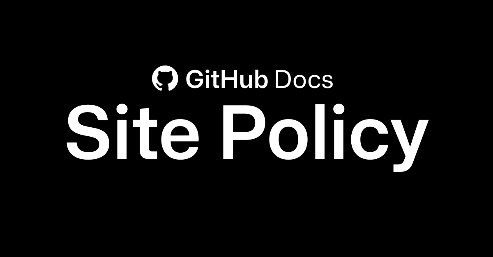
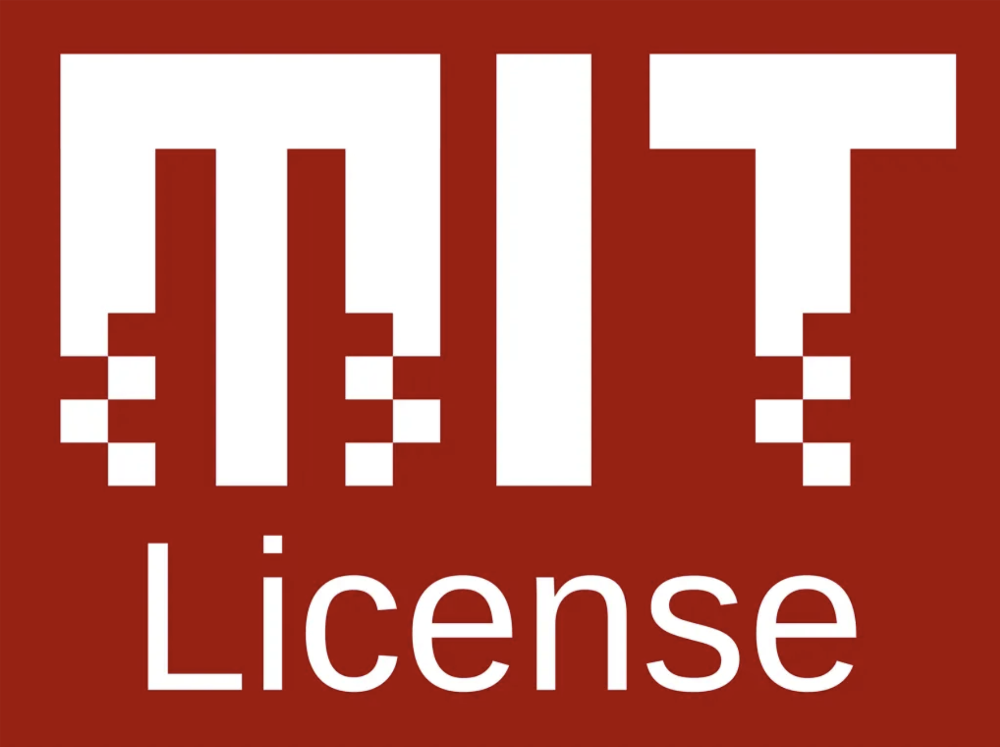

<!-- ═══════════════════════════════════════════════════════════════ -->
<!--                    ECO-SYS LICENSE HEADER                     -->
<!-- ═══════════════════════════════════════════════════════════════ -->

  
  &nbsp;&nbsp;&nbsp;&nbsp;
  
  &nbsp;&nbsp;&nbsp;&nbsp;
  

  <strong>MIT OPEN SOURCE LICENSE</strong>
   
  Powered by the principles of open collaboration, transparency, and innovation.

  <strong>ECO-SYS</strong> · An independent ecosystem by <a href="https://github.com/simoouahbiGHALINOA">simoouahbiGHALINOA</a>
   
  Open source foundation · Independent development · Community collaboration

  <a href="https://opensource.org/licenses/MIT">MIT License</a>
  &nbsp;•&nbsp;
  <a href="https://www.0661619230.com">Official ECO-SYS Website</a>
  &nbsp;•&nbsp;
  <a href="https://github.com/simoouahbiGHALINOA">ECO-SYS Owner</a>

  
    The MIT logo is displayed for identification purposes only.
    This project is independent and is not affiliated with, sponsored by,
    or endorsed by the Massachusetts Institute of Technology (MIT).
  

<!-- ═══════════════════════════════════════════════════════════════ -->
<!--                      END LICENSE HEADER                        -->
<!-- ═══════════════════════════════════════════════════════════════ -->

# MIT License

Copyright (c) 2026 simoouahbiGHALINOA

Permission is hereby granted, free of charge, to any person obtaining a copy
of this software and associated documentation files (the "Software"), to deal
in the Software without restriction, including without limitation the rights
to use, copy, modify, merge, publish, distribute, sublicense, and/or sell
copies of the Software, and to permit persons to whom the Software is
furnished to do so, subject to the following conditions:

The above copyright notice and this permission notice shall be included in all
copies or substantial portions of the Software.

THE SOFTWARE IS PROVIDED "AS IS", WITHOUT WARRANTY OF ANY KIND, EXPRESS OR
IMPLIED, INCLUDING BUT NOT LIMITED TO THE WARRANTIES OF MERCHANTABILITY,
FITNESS FOR A PARTICULAR PURPOSE AND NONINFRINGEMENT. IN NO EVENT SHALL THE
AUTHORS OR COPYRIGHT HOLDERS BE LIABLE FOR ANY CLAIM, DAMAGES OR OTHER
LIABILITY, WHETHER IN AN ACTION OF CONTRACT, TORT OR OTHERWISE, ARISING FROM,
OUT OF OR IN CONNECTION WITH THE SOFTWARE OR THE USE OR OTHER DEALINGS IN THE
SOFTWARE.

---

# 🌍 ECO — Mission, Vision & Independence

> **ONE WORLD. MANY CREATORS. INDEPENDENT IDENTITIES.**

## 👤 Repository owner and ECO creator

The GitHub owner of this repository is **simoouahbiGHALINOA**. ECO was initiated and developed by **simoouahbiGHALINOA**.

- **Repository owner profile:** [simoouahbiGHALINOA](https://github.com/simoouahbiGHALINOA)
- **ECO creator profile:** [simoouahbiGHALINOA](https://github.com/simoouahbiGHALINOA)
- **This repository:** [simoouahbiGHALINOA.github.io](https://github.com/simoouahbiGHALINOA/simoouahbiGHALINOA.github.io)
- **ECO website:** [www.0661619230.com](https://www.0661619230.com)

These details identify the repository and ECO's origin. They do not claim ownership of GitHub, third-party services, or work independently created by other people.

## 🌱 Our mission

ECO is a community-focused initiative with a non-commercial mission: to help people around the world become developers of their own systems, applications, platforms, websites, and digital services.

The purpose is to encourage learning, creativity, and independence—not to make people dependent on one provider or take ownership of what they build.

> 💡 **Build your own system. Learn by creating. Keep your work and identity independent.**

The non-commercial description refers to ECO's mission. It does not add a non-commercial restriction to the Software or change the permissions granted by the MIT License.

## 🚀 What you can create

Everyone should have the opportunity to imagine, build, improve, and manage their own:

- 💻 Software, tools, and developer projects
- 📱 Applications and digital services
- 🌐 Websites and online platforms
- 🤖 AI-powered tools and systems
- 🎨 Creative projects and digital experiences
- 🌱 Personal or professional digital ecosystems

Choose the tools, technologies, hosting, and ways of sharing that fit your goals.

## 🧭 Independence and ownership

Independence is central to ECO. People should be able to develop their own ideas, make their own choices, and keep their own identities.

- Work created independently belongs to its respective rights holders, subject to applicable licenses and agreements.
- Using or learning from ECO does not automatically transfer ownership of independent work to ECO.
- Hosting work on a third-party platform does not, by itself, transfer its copyright to that platform.
- Other people's work and rights remain their own.

## 🌐 GitHub and hosting

GitHub is an independent platform for hosting and collaborating on software. ECO does not own or operate GitHub.

Hosting this repository on GitHub does not make GitHub the owner of its contents. This repository remains governed by its MIT License, its notices, and applicable platform terms.

## 🎨 ECO identity and original materials

The ECO name, logo, and original creative materials made for the project may have rights separate from the Software covered by MIT. This notice does not claim ownership of general ideas, third-party materials, or work independently created by other people.

The MIT License above continues to apply to the Software it covers. This additional description does not revoke or restrict permissions already granted under MIT.

## 🤝 Learn, build, and share

ECO welcomes developers to explore, learn, experiment, share knowledge, and build useful things of their own. Collaboration should respect each person's independence, contributions, and applicable licenses.

There is no single required way to build a digital project. Choose a path that fits your goals, abilities, and ideas.

## ✨ A shared goal

ECO aims to make independent digital creation more accessible to people around the world.

> **Build your system. Own your work. Create your ecosystem.**

---

This section describes ECO's mission and identity. It does not replace or alter the MIT License above.
