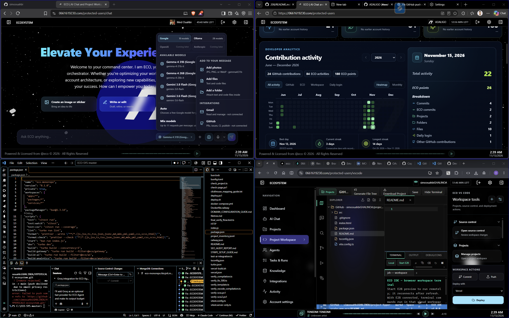
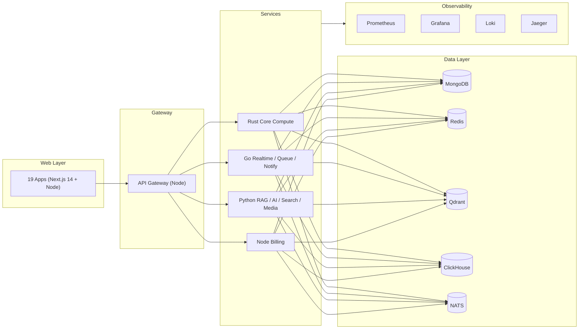
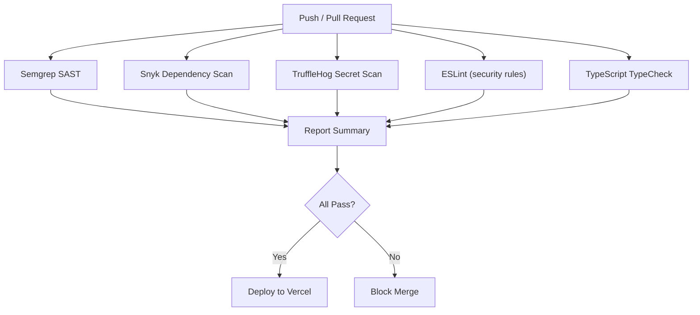
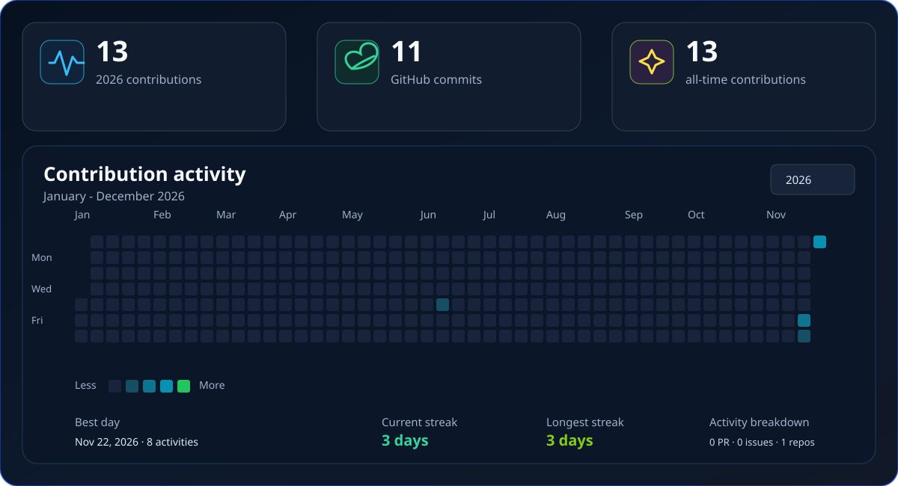

# simoouahbiGHALINOA.github.io
🌍 Welcome to my Developer Universe! 🚀 💻 Open Source • 🧠 Innovation • 🦀 Rust • 🐹 Go • 🐍 Python • 🔷 TypeScript • 🟨 JavaScript • 🗄️ SQL • 🎨 CSS • 🌐 HTML • 🛠️ Tools • 🧩 Starters • ⚡ Experiments | 👨‍💻 @simoouahbiGHALINOA

<div align="center">



<a href="https://github.com/simoouahbiGHALINOA/HYPERSCALE-ecosystem">
  
</a>

<p align="center">
  
  
  
  
  
  
  
  
  
  
  
  
  
  
  
</p>

</div>

---

## GitHub Pages Routes & Assets

This is a root-level GitHub Pages site for `simoouahbiGHALINOA.github.io`.

| Page | URL |
|------|-----|
| Home | <https://simoouahbiGHALINOA.github.io/> |
| About | <https://simoouahbiGHALINOA.github.io/about.html> |
| Work timeline | <https://simoouahbiGHALINOA.github.io/timeline.html> |
| Protected users | <https://simoouahbiGHALINOA.github.io/protectedUSERS_root_path_secure/> |

Static files are stored in `public/` and are served from the site root. For example, `public/assets/readme-3d-banner.png` is available at `/assets/readme-3d-banner.png`. GitHub profile links open the profile; visitors must click **Follow** on GitHub themselves while signed in. The dedicated Follow buttons also update an aggregate click counter; it does not detect or claim that a visitor followed.

## API and database

The GitHub Pages site remains the public frontend at `https://simoouahbighalinoa.github.io`. GitHub Pages only serves static files, so the Prisma API in [`api/`](./api/) must run on a server host (for example Railway); the browser talks to that API and never receives database credentials. The API supports PostgreSQL and MongoDB through separate Prisma schemas. MongoDB is the initial provider in `api/.env.example`; set `DATABASE_PROVIDER=postgresql` to choose PostgreSQL instead. One provider is active per API deployment; the two databases are alternatives, not dual-written replicas. The API also handles GitHub OAuth and stores user profiles and hashed sessions in the selected database.

For local development:

1. Copy [`api/.env.example`](./api/.env.example) to `api/.env`, set `DATABASE_URL`, and configure a GitHub OAuth App using `GITHUB_CLIENT_ID`, `GITHUB_CLIENT_SECRET`, and `GITHUB_CALLBACK_URL`.
2. From `api/`, run `npm ci`, then `npm run db:push:mongodb` or `npm run db:migrate:postgres` to create the models in the selected database.
3. Run `npm run dev` in `api/`, then copy [`.env.example`](./.env.example) to `.env.local` and set `VITE_API_BASE_URL=http://localhost:8787`.
4. In the GitHub repository's **Settings → Secrets and variables → Actions → Variables**, set `VITE_API_BASE_URL` to the deployed API's public URL. The Pages workflow injects this public endpoint when it builds the frontend; database credentials belong only in the API host's environment.

For PostgreSQL production deployments, apply the checked-in Prisma migration with `npm run db:migrate:postgres`. For MongoDB, run `npm run db:push:mongodb` against the configured database. The first successful GitHub sign-in creates a user document in MongoDB's `protected_users` collection. See [`api/README.md`](./api/README.md) for the OAuth, deployment, and database inspection steps.

The SQL starter separately saves its runnable example to a local SQLite database at `starters/sql/eco.db`.

---

## 📖 Overview

**ECOS-SYS** is a full-stack, polyglot monorepo that powers a real-time, AI-enhanced ecosystem of services. It combines:

- **Rust** for high-performance vector engines and core compute.
- **Go** for low-latency realtime websockets, queues, and notifications.
- **Python (FastAPI)** for AI/ML micro-services (RAG, search, media processing).
- **Node.js / Next.js 14** for the web front-end and API gateway.

The repo is orchestrated with **TurboRepo**, containerised via **Docker Compose**, deployed on **Vercel** (apps/ecosystem), and observed with a full Prometheus/Grafana/Loki/Jaeger stack.

---

## ✨ Features

| ✅ | Feature |
|---|---------|
| ⚡️ | Ultra-fast vector similarity search (Rust + Qdrant). |
| 🌐 | Real-time bidirectional communication via Go WebSockets. |
| 🤖 | AI-driven endpoints powered by Python RAG + sentence-transformers. |
| 📊 | Built-in Prometheus metrics and Grafana dashboards. |
| 🛠️ | Modular monorepo with 19 apps, 41 packages, 7 services. |
| 🚀 | CI/CD pipelines with GitHub Actions & Vercel deploy scripts. |
| 🔐 | Security pipeline: Semgrep, Snyk, TruffleHog, ESLint, typecheck. |
| 📅 | Daily Vercel cron for scheduled chat tasks (09:00 UTC). |
| 🔭 | Distributed tracing via OpenTelemetry + Jaeger. |

---

## 🏗️ Architecture Diagram



---

## ☁️ Providers & Services

| Provider | Service |
|----------|---------|
| **Docker** | Containerisation of all services via Docker Compose. |
| **Vercel** | Front-end (Next.js) hosting for apps/ecosystem + daily cron. |
| **MongoDB** | Primary NoSQL database. |
| **Redis** | Cache & message broker. |
| **Qdrant** | Vector database for AI/RAG. |
| **ClickHouse** | Analytics database. |
| **NATS** | Messaging system (JetStream). |
| **GitHub** | Source control & CI workflows. |

---

## 🗣️ Languages

The starter kit keeps one runnable example per language in a separate folder. Each receives an equal **12.5% starter share**; this is a visual comparison, not a claim that the repository contains equal amounts of each language. The site also calculates real source-file shares by bytes and file counts from `src/`, `starters/`, and `api/`, excluding assets, dependencies, and build output. The starter source is explicitly included in GitHub Linguist statistics; GitHub may take time to refresh the repository language bar after a push.

<!-- language-metrics:start -->
| Language | Equal starter share | Measured source share | Files | File types | Starter |
|----------|---------------------|-----------------------|-------|------------|---------|
| 🦀 Rust | 12.5% | 2.2% | 1 | `.rs` | [Open](./starters/rust/README.md) |
| 🐹 Go | 12.5% | 1.9% | 2 | `.go` | [Open](./starters/go/README.md) |
| 🐍 Python | 12.5% | 4.5% | 4 | `.py` | [Open](./starters/python/README.md) |
| 🔷 TypeScript | 12.5% | 64.5% | 20 | `.ts, .tsx` | [Open](./starters/typescript/README.md) |
| ⚡ JavaScript | 12.5% | 2.0% | 4 | `.js, .mjs, .cjs` | [Open](./starters/javascript/README.md) |
| 🗃️ SQL | 12.5% | 1.6% | 5 | `.sql` | [Open](./starters/sql/README.md) |
| 🎨 CSS | 12.5% | 21.8% | 3 | `.css` | [Open](./starters/css/README.md) |
| 🌐 HTML | 12.5% | 1.5% | 2 | `.html, .htm` | [Open](./starters/html/README.md) |
<!-- language-metrics:end -->

Language metrics are generated with `npm run generate:language-metrics` before development and production builds. See the live cards on the [home page](https://simoouahbiGHALINOA.github.io/#languages). All first-party starter code uses the repository's MIT license; the SPDX headers and root [LICENSE](./LICENSE) are the source of truth.

## 🧰 Separated Starter Kit

Start with the [starter kit guide](./starters/README.md). Each language folder has its own files and run instructions; the [starter validation workflow](./.github/workflows/starter-kits.yml) checks the runnable examples.

---

## 🔐 Security Pipeline



Security commands:

```bash
npm run security:check        # env + audit
npm run security:check:fast   # env only
npm run security:full        # full scan + Semgrep
npm run security:env-check   # validate env vars
npm run security:audit       # dependency audit
npm run security:semgrep     # Semgrep scan
```


---

## ⚡ Turbo Commands

| Command | Description |
|---------|-------------|
| `bun run dev` | Start all apps in watch mode (Turbo). |
| `bun run build` | Build all apps/packages (concurrency 1). |
| `bun run build:ecosystem` | Build apps/ecosystem (Vercel target). |
| `bun run build:gateway` | Build @eco/gateway. |
| `bun run build:ai` | Build @eco/ai. |
| `bun run build:analytics` | Build @eco/analytics. |
| `bun run build:chat` | Build @eco/chat. |
| `bun run build:cloud` | Build @eco/cloud. |
| `bun run build:dashboard` | Build @eco/dashboard. |
| `bun run build:ecommerce` | Build @eco/ecommerce. |
| `bun run build:maps` | Build @eco/maps. |
| `bun run build:marketplace` | Build @eco/marketplace. |
| `bun run build:notifications` | Build @eco/notifications. |
| `bun run build:payments` | Build @eco/payments. |
| `bun run build:realtime` | Build @eco/realtime. |
| `bun run build:search-engine` | Build @eco/search-engine. |
| `bun run build:streaming` | Build @eco/streaming. |
| `bun run generate` | Generate Prisma clients. |
| `bun run typecheck` | Type-check all workspaces. |
| `bun run test` | Run Vitest suite. |
| `bun run test:cov` | Run tests with coverage. |
| `bun run clean:ports` | Kill dev ports. |
| `bun run deploy:ecosystem` | Build + deploy ecosystem to Vercel. |
| `bun run security:full` | Full security scan. |

---

## 📚 Docs Hub

| Document | Description |
|----------|-------------|
| [File-by-file repository reference](docs/reference/README.md) | Centralized documentation for every tracked repository file. |
| [START_HERE.md](docs/START_HERE.md) | 3-command security verification. |
| [SECURITY.md](docs/SECURITY.md) | Security implementation guide. |
| [DEPLOYMENT_GUIDE.md](docs/DEPLOYMENT_GUIDE.md) | General deployment guide. |
| [VERCEL_DEPLOYMENT.md](docs/VERCEL_DEPLOYMENT.md) | Vercel deployment. |
| [VERCEL_DEPLOYMENT_PLAYBOOK.md](docs/VERCEL_DEPLOYMENT_PLAYBOOK.md) | Vercel playbook. |
| [VERCEL_ECOSYSTEM_ENV_GUIDE.md](docs/VERCEL_ECOSYSTEM_ENV_GUIDE.md) | Ecosystem env vars. |
| [VERCEL_ENV_GUIDE.md](docs/VERCEL_ENV_GUIDE.md) | Vercel env guide. |
| [RAILWAY_DEPLOYMENT_GUIDE.md](docs/RAILWAY_DEPLOYMENT_GUIDE.md) | Railway deployment. |
| [COMMUNICATION_ENV_GUIDE.md](docs/COMMUNICATION_ENV_GUIDE.md) | Communication env guide. |
| [AGENTIC_STRUCTURE_PLAN.md](docs/AGENTIC_STRUCTURE_PLAN.md) | Agentic structure plan. |
| [STRIPE_SETUP_GUIDE.md](STRIPE_SETUP_GUIDE.md) | Stripe setup. |
| [DOMAIN_CONFIGURATION_GUIDE.md](DOMAIN_CONFIGURATION_GUIDE.md) | Domain configuration. |

---

## 🗺️ Roadmap

- [x] Polyglot monorepo (Rust/Go/Python/Node)
- [x] 19 apps + 41 packages + 7 services
- [x] Docker Compose full stack
- [x] Vercel deploy of apps/ecosystem
- [x] Daily cron (09:00 UTC) for scheduled chat tasks
- [x] Observability stack (Prometheus/Grafana/Loki/Jaeger)
- [x] Security pipeline (Semgrep/Snyk/TruffleHog)
- [ ] RBAC + MFA for admin accounts
- [ ] Database encryption at rest
- [ ] Audit logging dashboard
- [ ] Bug bounty program

---

## 📊 Metrics

<div align="center">

<a href="https://github.com/simoouahbiGHALINOA">
  
</a>

</div>

---

## 📸 Activity Timeline & Project Preview

<p align="center">
  <strong>ECOS-SYS work video</strong><br />
  <video src="public/assets/ecosys-timeline-playback.mp4" controls playsinline preload="metadata" poster="public/assets/timeline-video-preview.gif" width="100%">
    Your browser cannot play the embedded video. <a href="public/assets/ecosys-timeline-playback.mp4">Open the MP4 video.</a>
  </video><br />
  <a href="https://simoouahbiGHALINOA.github.io/timeline.html">Open the full screenshot timeline</a> ·
  <a href="public/assets/ecosys-timeline-playback.mp4">Open video file</a>
</p>

<p align="center">
  <strong>November 5, 2026 — 18:52</strong><br />
  
</p>

<p align="center">
  <strong>November 5, 2026 — 22:06</strong><br />
  
</p>

<p align="center">
  <strong>November 6, 2026 — 04:08</strong><br />
  
</p>

<p align="center">
  <strong>November 6, 2026 — 04:14</strong><br />
  
</p>

<p align="center">
  <strong>November 6, 2026 — 20:28</strong><br />
  
</p>

<p align="center">
  <strong>November 6, 2026 — 20:39</strong><br />
  
</p>

<p align="center">
  <strong>November 7, 2026 — 04:07</strong><br />
  
</p>

<p align="center">
  <strong>November 7, 2026 — 21:01</strong><br />
  
</p>

<p align="center">
  <strong>November 9, 2026 — 01:59</strong><br />
  
</p>

<p align="center">
  <strong>November 9, 2026 — 12:00</strong><br />
  
</p>

<p align="center">
  <strong>November 9, 2026 — 12:02</strong><br />
  
</p>

<p align="center">
  <strong>November 9, 2026 — 14:41</strong><br />
  
</p>

<p align="center">
  <strong>November 12, 2026 — 00:44</strong><br />
  
</p>

---

## 🧭 Engineering Philosophy

<div align="center">

> *"Build systems that scale horizontally, fail gracefully, and stay observable."*

**ECOS-SYS** is engineered for hyperscale: polyglot by design, modular by default, observable by necessity.

</div>

<div align="center">


</div>

---

<div align="center">

**Maintainer**: simoouahbiGHALINOA · **License**: MIT · **Repo**: [HYPERSCALE-ecosystem](https://github.com/simoouahbiGHALINOA/HYPERSCALE-ecosystem)

</div>


<div align="center">

Hi, that's me, **simoouahbiGHALINOA**. I created this repo, I am the owner, and I am the one who is maintaining it. I will continue to maintain it for a long time, adding more features to make it better, the best, most popular, useful, awesome, amazing, incredible, fantastic, spectacular, stunning, breathtaking, astonishing, astounding, and astonishment-inducing repo ever.

NEXT to: Ghali and Noa
</div>

<!-- Account verification: simoouahbiGHALINOA -->

